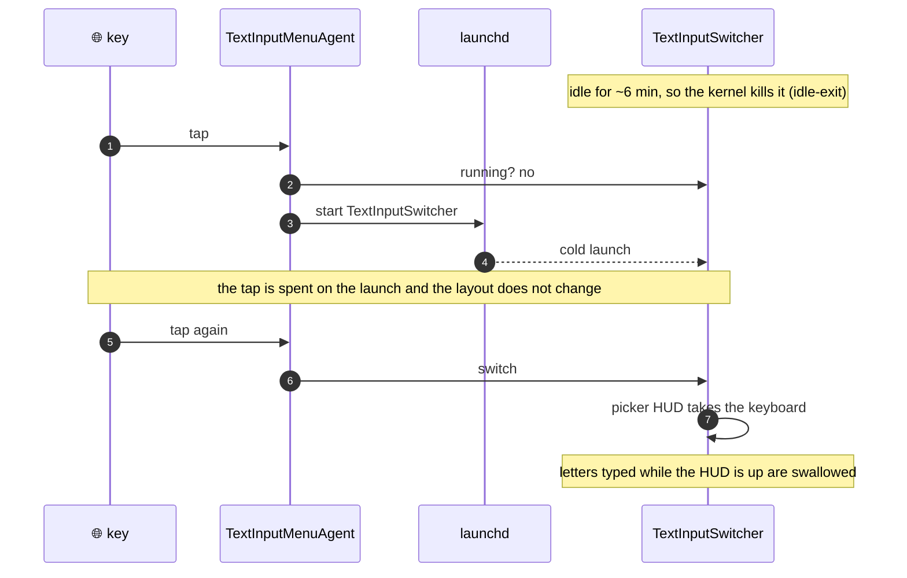
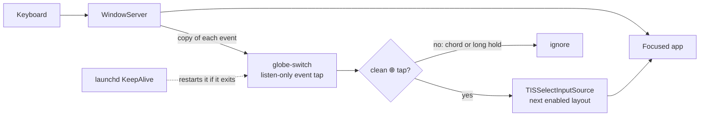
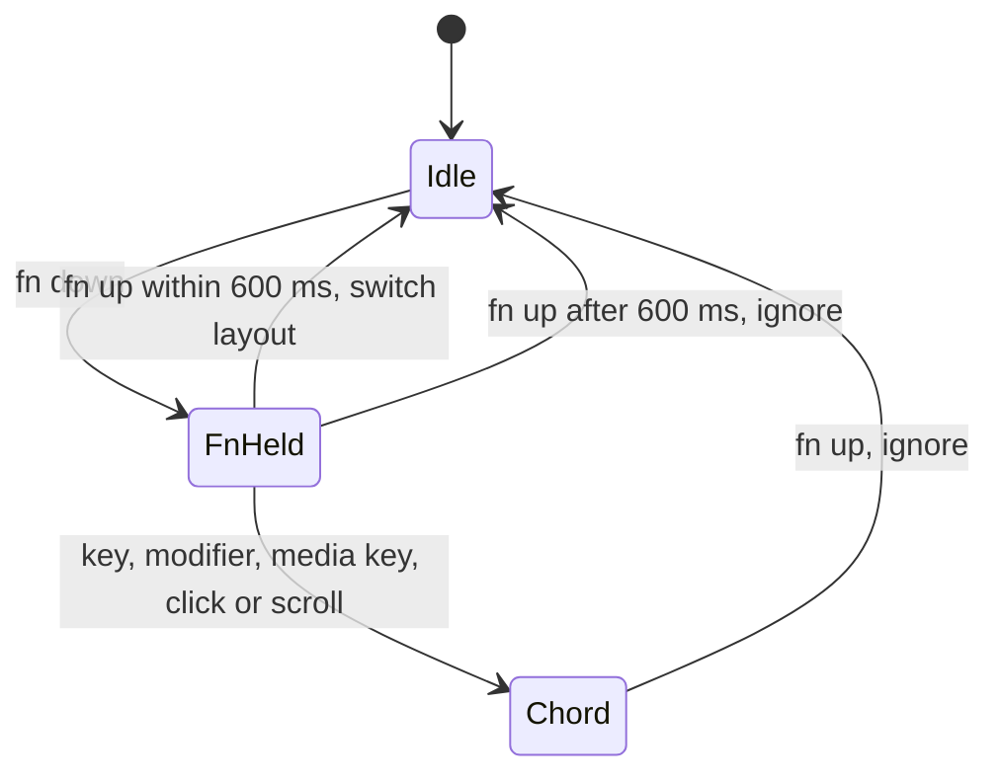
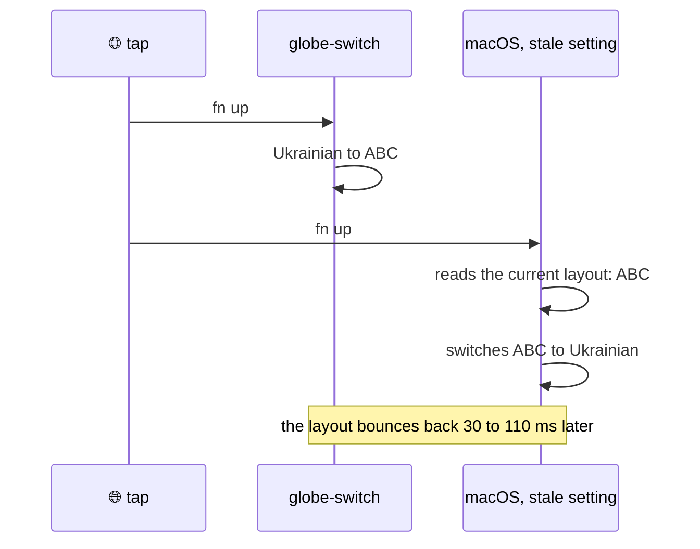

# globe-switch

[](#install)
[](https://github.com/dmytro-yemelianov/globe-switch/actions/workflows/ci.yml)
[](Package.swift)
[](#footprint)
[](LICENSE)

Tap 🌐 to switch keyboard layouts on macOS, instantly, every time.

globe-switch is a tiny always-on agent, packaged as GlobeSwitch.app, that replaces the system's Globe-key handler. It switches on the first tap, even after the Mac has been idle, and never shows a picker that swallows the next letters you type.

## Why

On macOS, a 🌐 tap goes through `TextInputSwitcher`, an on-demand helper that launchd idle-kills a few minutes after each use. When it is gone, the tap only gets it relaunched and the layout stays the same. When it is running, it shows a picker HUD that grabs the keyboard, so letters typed right after the switch can vanish.



This is not caused by low memory. On the author's Mac, launchd relaunched `TextInputSwitcher` 53 times in three days, and the kernel log said `memorystatus: killing (idle) TextInputSwitcher … idle-exit` while about 10 GB of memory was available. The launchd plist that allows this is on the sealed system volume, so it cannot be changed.

## How it works



- **Listen-only event tap.** globe-switch receives a copy of each keyboard event and passes it on immediately, so it can never block or delay typing, even if it hangs.
- **Clean-tap detection.** A switch happens only when 🌐 is released within 600 ms with nothing else pressed while it was held. That keeps fn+arrows, fn+E (emoji), fn+F-keys, and the media keys working as before.
- **Direct switch.** The layout changes through the Text Input Sources API in the same event callback: no helper process, no HUD, no animation.
- **Always running.** A `KeepAlive` LaunchAgent starts GlobeSwitch.app's agent at login. It is not an on-demand service, so launchd never idle-kills it, and it restarts the agent if it crashes.
- **Self-checks.** Every 30 seconds the agent checks that it still has Input Monitoring access. If the access was revoked, the tap would go deaf without any error, so the agent restarts and waits for the grant instead. It also notices when 🌐 is no longer set to **Do Nothing** and logs that taps may bounce.



With two layouts a tap toggles between them. With more, it moves to the next enabled layout in system order, or back to the previous one with `CycleOrder=recent` (see [Settings](#settings)).

## Install

Requirements:

- macOS 13 or later, and a Mac keyboard with a 🌐 key.
- Xcode Command Line Tools (`xcode-select --install`) for `swift`.

Tested on macOS 27.2 on Apple Silicon. CI also builds for Intel.

GlobeSwitch is not notarized, so there is no download to double-click. Both ways below build it on your Mac.

### Homebrew

```sh
brew install dmytro-yemelianov/tap/globe-switch
globe-switch install
```

Run `globe-switch install` again after each `brew upgrade`. Homebrew signs its builds ad-hoc, so after an upgrade Input Monitoring has to be granted again: remove GlobeSwitch from the list with **−** and run `globe-switch install`.

### From source

```sh
git clone https://github.com/dmytro-yemelianov/globe-switch.git
cd globe-switch
./install.sh
```

`install.sh` builds GlobeSwitch.app, signs it, runs `globe-switch install` and links `~/.local/bin/globe-switch`. If you have an `Apple Development` signing identity, it signs with that, and the Input Monitoring grant survives rebuilds; otherwise it signs ad-hoc. To pick a different identity, set `GLOBE_SWITCH_IDENTITY`.

### What `globe-switch install` does

1. Copies GlobeSwitch.app to `~/Applications`.
2. Writes `~/Library/LaunchAgents/dev.yemelianov.globe-switch.plist`, which starts the agent from `~/Applications/GlobeSwitch.app` at login, and loads it. The plist names the app in `AssociatedBundleIdentifiers`, so **System Settings → General → Login Items & Extensions** lists it as GlobeSwitch, where it can be turned off.
3. Records what **System Settings → Keyboard → Press 🌐 key to** was set to, then sets it to **Do Nothing**, so macOS and globe-switch don't both switch on the same tap.
4. Restarts `TextInputMenuAgent` and `TextInputSwitcher`. They read that setting only at launch, so without a restart they would keep switching too (see [Troubleshooting](#troubleshooting)). launchd relaunches both on demand.
5. Runs `globe-switch doctor` to show whether everything is in place.

Opening GlobeSwitch.app from Finder does the same and shows the doctor's report in a window.

Then turn on **GlobeSwitch** in **System Settings → Privacy & Security → Input Monitoring**. macOS caches the permission answer for the life of a process, so the waiting agent checks with a fresh copy of itself every two seconds. Once access is granted, it exits and launchd restarts it with the permission in effect.

**Upgrading from 0.1 or 0.2.** Those versions ran a bare binary from `~/.local/bin`. `globe-switch install` points the LaunchAgent at GlobeSwitch.app and removes the old binary. Input Monitoring then needs a new grant for GlobeSwitch, and the old `globe-switch` entry can be removed with **−**.

### Uninstall

```sh
globe-switch uninstall            # or ./install.sh uninstall
brew uninstall globe-switch       # if installed with Homebrew
```

This removes the LaunchAgent and `~/Applications/GlobeSwitch.app`, and sets 🌐 back to what it was before the first install. Installs from before 0.2 did not record that, so after one of them 🌐 goes back to **Change Input Source**.

## Settings

Settings live in the `dev.yemelianov.globe-switch` preferences domain. The agent rereads them on every 🌐 press, so there is nothing to restart.

| Setting | Default | |
|---|---|---|
| `TapWindowMilliseconds` | `600` | How long 🌐 may be held and still count as a tap (100–2000) |
| `SkippedLayouts` | none | Layouts a tap never switches to, as IDs from `globe-switch --list` |
| `CycleOrder` | `list` | `list` goes to the next layout in system order; `recent` goes back to the previous one, like a quick Ctrl+Space |
| `ShowIndicator` | `true` | Shows the layouts' flags for a moment after each switch, the new one in the middle |
| `LayoutFlags` | none | Your own flag per layout: a region code such as `GB`, or any text |
| `PlaySound` | `true` | Plays a short click after each switch |
| `Sound` | `Click` | GlobeSwitch's own soft click, a little higher or lower for each layout, or a sound from `/System/Library/Sounds` (`Tink`, `Pop`, …) or `~/Library/Sounds`, the same for every layout |
| `SoundVolume` | `0.35` | Relative to the system volume, from 0 to 1 |

```sh
defaults write dev.yemelianov.globe-switch CycleOrder -string recent
defaults write dev.yemelianov.globe-switch SkippedLayouts -array com.apple.keylayout.Russian
defaults write dev.yemelianov.globe-switch LayoutFlags -dict com.apple.keylayout.ABC GB
defaults write dev.yemelianov.globe-switch ShowIndicator -bool false
defaults write dev.yemelianov.globe-switch SoundVolume -float 0.2
defaults write dev.yemelianov.globe-switch PlaySound -bool false
defaults delete dev.yemelianov.globe-switch ShowIndicator    # back to the default
```

The indicator lines up every layout's flag, with no background around them. The active one sits in the middle, larger and glowing in your accent colour; on a switch the row slides so the new layout moves to the middle. Each layout gets the flag of the country it is named after (British → 🇬🇧), otherwise the usual one for its language (Ukrainian → 🇺🇦, ABC → 🇺🇸), or yours from `LayoutFlags`. A layout without any flag shows its name. `globe-switch doctor` lists the flags it will use.

The flags are pixel art: sharp rectangles of 22 × 14 pixels, one for each of the 259 regions macOS has a flag emoji for (Nepal keeps its pennant shape). They live as text, one letter per pixel, in [`FlagCorpus.swift`](Sources/GlobeSwitchCore/FlagCorpus.swift): they started as public-domain flag drawings scaled down to the grid, and the ones with stars, emblems and diagonals were redrawn by hand. To change a flag, edit its block there.

The indicator cannot take keystrokes the way macOS's picker does. It is a panel that never becomes the key window, doesn't activate GlobeSwitch, and ignores the mouse; `tools/globe-probe type` checks that every letter typed right after a tap still arrives, and refuses to type when another app is in front.

## Privacy

Input Monitoring lets an app see every key you press, so here is exactly what GlobeSwitch does with it:

- It reads the key code and modifier flags of each event to recognise the fn key, and only notes that *some* other key, click or scroll happened while fn was held. It never reads which character was typed.
- It stores nothing about your typing and logs only its own state (start, permission changes, bounces, failed switches).
- It makes no network connections and has no telemetry.
- The event tap is listen-only, so it cannot change, delay or block what you type.

The whole app is about 1,300 lines of Swift in [`Sources`](Sources), with no dependencies, plus the 4,300-line flag corpus.

## Troubleshooting

Start with the doctor. It asks the running agent for its state and checks the LaunchAgent, the signature, the 🌐 setting, the layouts and your settings:

```console
$ globe-switch doctor
globe-switch 0.6.0
✓ agent      running (pid 91028), listening for 🌐 taps
✓ login      starts at login (~/Library/LaunchAgents/dev.yemelianov.globe-switch.plist)
✓ signature  Apple Development: you@example.com (ABCDE12345), so Input Monitoring stays granted across updates
✓ globe key  Press 🌐 key to: Do Nothing (globe-switch handles it)
✓ layouts    🇺🇸 ABC → 🇺🇦 Ukrainian
✓ settings   defaults
✓ activity   12 switches since the agent started (last one 40 s ago), 0 bounced back

All good.
```

Every problem it finds comes with a fix, and it exits with status 1.

The agent logs to the unified log, which macOS rotates on its own. When everything works, the log stays quiet. It gets a line only when something goes wrong:

| Log line | Meaning | Fix |
|---|---|---|
| `waiting for Input Monitoring access` | No keyboard events yet | Turn on GlobeSwitch in Input Monitoring |
| `waiting for Input Monitoring access` while GlobeSwitch is already on in the list | The entry was recorded for an earlier signature (an ad-hoc rebuild or another signing identity), so turning it on does nothing | Remove it with **−**, then run `globe-switch install` again |
| `Input Monitoring access was revoked` | The permission was turned off while the agent was running | Turn it on again; the agent picks it up within two seconds |
| `🌐 is set to …, so macOS reacts to taps too` | The 🌐 setting is no longer **Do Nothing** | Run `globe-switch install` again |
| `bounced to … ms after a tap` | Something switched the layout back right after a tap. Usually macOS is still handling 🌐 | Check that 🌐 is set to **Do Nothing**, then run `globe-switch install` again |
| `fn held N ms, too long for a tap` | 🌐 was held past the tap window | Tap shorter, or raise `TapWindowMilliseconds` |
| `TISSelectInputSource(…) failed` | macOS refused the switch | Open an issue with the log line |

A bounce looks like this. If `TextInputMenuAgent` and `TextInputSwitcher` are still running from before the setting changed, both switchers react to the same tap. When macOS is slow after a pause, it reads the layout globe-switch has just selected and switches it back:



Useful commands:

```sh
/usr/bin/log show --last 1d --predicate 'subsystem == "dev.yemelianov.globe-switch"'
/usr/bin/log stream --predicate 'subsystem == "dev.yemelianov.globe-switch"'
launchctl print gui/$(id -u)/dev.yemelianov.globe-switch | grep -E 'state|pid|runs'
globe-switch --list    # the layout IDs a tap cycles through
globe-switch run       # run the agent in the terminal; stop the LaunchAgent first with launchctl bootout
```

Use the full path `/usr/bin/log`: in zsh, the default macOS shell, a bare `log` runs a built-in command instead.

## Testing

The tap detection (taps, chords, long holds), the layout choice (list and recent order, skipped layouts) and the settings parsing are plain Swift in `GlobeSwitchCore`, tested without any permissions:

```sh
swift test
```

With only the Command Line Tools for macOS 27, `swift test` sometimes fails with `plugin for module 'TestingMacros' not found`. Passing the plugin path explicitly avoids it:

```sh
swift test -Xswiftc -plugin-path -Xswiftc /Library/Developer/CommandLineTools/usr/lib/swift/host/plugins/testing
```

CI builds the package with warnings as errors for Apple Silicon and Intel, runs the tests, builds and verifies GlobeSwitch.app, and runs shellcheck on the scripts.

### Without pressing the key

`tools/globe-probe.swift` sends synthetic 🌐 taps and measures whether the layout changed and how fast. Synthetic events reach globe-switch's event tap but not macOS's own 🌐 handling, so the probe tests globe-switch on its own. The terminal you run it from needs Accessibility access.

```sh
swiftc -O -o build/globe-probe tools/globe-probe.swift
./build/globe-probe press 4 400       # 4 taps, 400 ms apart: each should say SWITCHED
./build/globe-probe press 3 600 40    # tap, then shift 40 ms later: must not bounce
./build/globe-probe chord             # fn+shift: NO-SWITCH(ok)
./build/globe-probe hold              # fn held 900 ms: NO-SWITCH(ok)
./build/globe-probe scroll            # fn held while scrolling: NO-SWITCH(ok)
./build/globe-probe type 5 40         # tap, then type 40 ms later: every letter arrives
```

The app icon is drawn by `swift tools/make-icon.swift`, which writes `App/AppIcon.icns`. The click is synthesized by the agent itself (`Click` in `GlobeSwitchCore`): a 40 ms damped tone at 1.6 kHz for the first layout in system order, then up a major third, a fifth and an octave for the next ones.

## Footprint

Measured on macOS 27.2, Apple Silicon:

| | |
|---|---|
| Source | Swift package, no dependencies: ~980 lines for the agent, indicator, installer and doctor, ~360 for the tested core, plus the flag corpus |
| App | 760 KB: a 496 KB executable (about 90 KB of it the flags), the rest is the icon |
| Memory | 8.3 MB physical footprint before the first switch, about 15 MB once the indicator and the click have been used (`ps` then shows ~50 MB RSS, mostly shared system frameworks) |
| CPU | 0% while idle; work happens on key events, plus a ~10 ms access check every 30 seconds |
| Network | none, and no telemetry |

## Limitations

- Only a 🌐 tap is handled. Ctrl+Space and the menu-bar input menu still go through macOS's own switcher.
- Not notarized: you build it yourself, from source or through Homebrew.
- Tested with keyboard layouts (ABC, Ukrainian-PC). Input methods such as Japanese or Chinese IMEs are untested; switching to them from a background process is known to be unreliable on macOS.
- Third-party keyboards without a real 🌐/fn key are not supported.
- Not tested at the lock screen or while an app holds Secure Keyboard Entry (password fields, some terminals). macOS may hide keys from event taps there, and with 🌐 set to **Do Nothing** a tap may then do nothing.

## License

[MIT](LICENSE)
