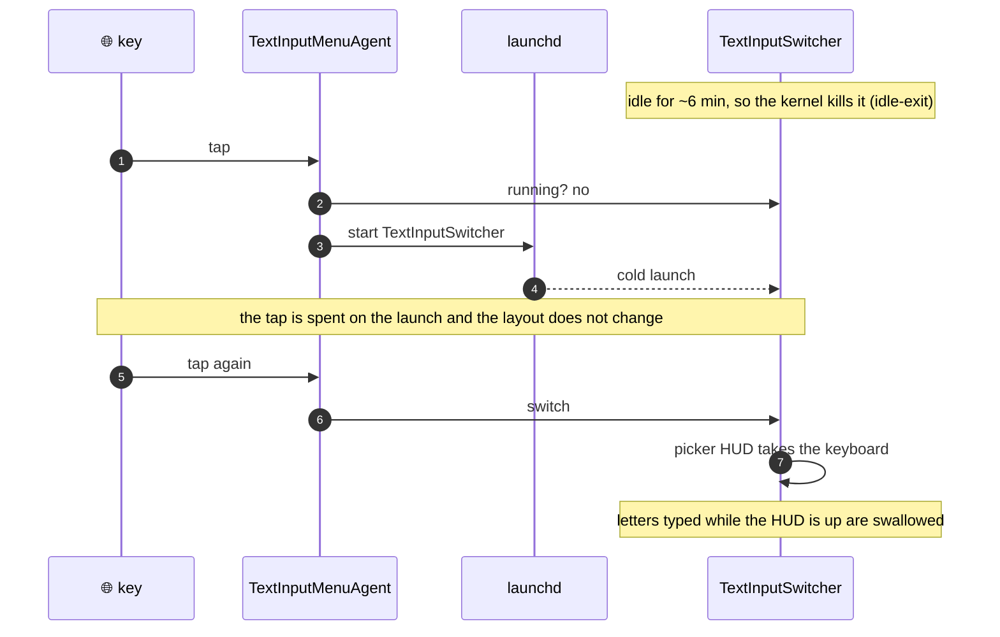
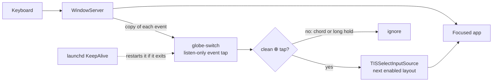
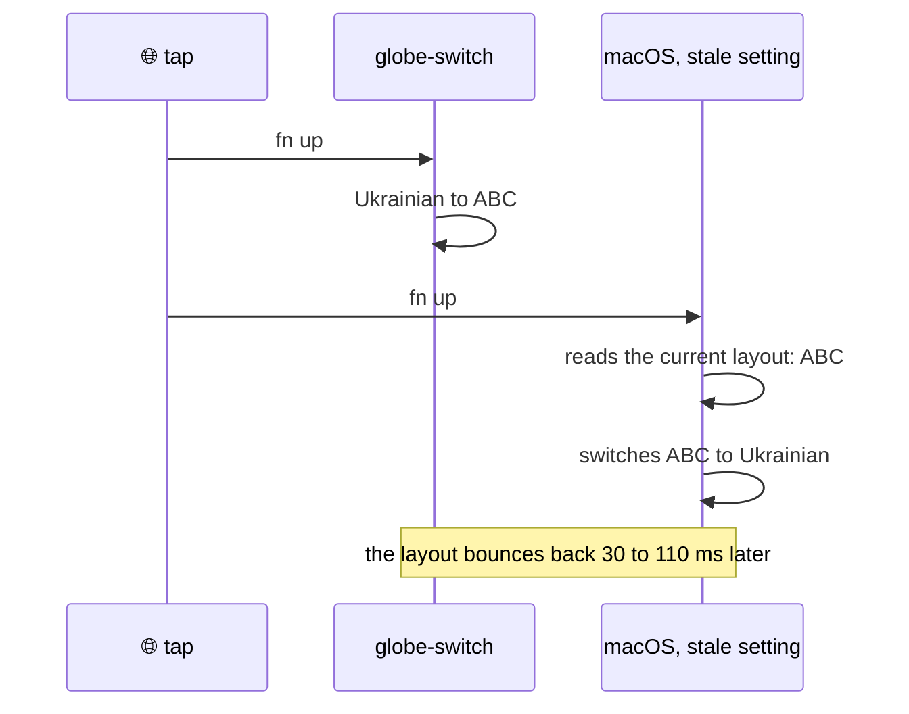

# globe-switch

[](#install)
[](GlobeSwitch.swift)
[](#footprint)
[](LICENSE)

Tap 🌐 to switch keyboard layouts on macOS, instantly, every time.

globe-switch is a tiny always-on LaunchAgent that replaces the system's Globe-key handler. It switches on the first tap, even after the Mac has been idle, and never shows a picker that swallows the next letters you type.

## Why

On macOS, a 🌐 tap goes through `TextInputSwitcher`, an on-demand helper that launchd idle-kills a few minutes after each use. When it is gone, the tap only gets it relaunched and the layout stays the same. When it is running, it shows a picker HUD that grabs the keyboard, so letters typed right after the switch can vanish.



This is not caused by low memory. On the author's Mac, launchd relaunched `TextInputSwitcher` 53 times in three days, and the kernel log said `memorystatus: killing (idle) TextInputSwitcher … idle-exit` while about 10 GB of memory was available. The launchd plist that allows this is on the sealed system volume, so it cannot be changed.

## How it works



- **Listen-only event tap.** globe-switch receives a copy of each keyboard event and passes it on immediately, so it can never block or delay typing, even if it hangs.
- **Clean-tap detection.** A switch happens only when 🌐 is released within 600 ms with nothing else pressed while it was held. That keeps fn+arrows, fn+E (emoji), fn+F-keys, and the media keys working as before.
- **Direct switch.** The layout changes through the Text Input Sources API in the same event callback: no helper process, no HUD, no animation.
- **Always running.** It is a `KeepAlive` LaunchAgent, not an on-demand service, so launchd never idle-kills it and restarts it if it crashes.


With two layouts a tap toggles between them. With more, it moves to the next enabled layout in system order.

## Install

Requirements:

- A Mac keyboard with a 🌐 key.
- Xcode Command Line Tools (`xcode-select --install`) for `swiftc`.

Tested on macOS 27.2 on Apple Silicon. Older releases with the "Press 🌐 key to" setting (macOS 11 and later) should work but have not been tested.

```sh
git clone https://github.com/dmytro-yemelianov/globe-switch.git
cd globe-switch
./install.sh
```

`install.sh` does the following:

1. Builds `GlobeSwitch.swift`, signs the binary, and installs it to `~/.local/bin/globe-switch`.
2. Writes and loads the LaunchAgent `~/Library/LaunchAgents/dev.yemelianov.globe-switch.plist`.
3. Sets **System Settings → Keyboard → Press 🌐 key to** to **Do Nothing**, so macOS and globe-switch don't both switch on the same tap.
4. Restarts `TextInputMenuAgent` and `TextInputSwitcher`. They read that setting only at launch, so without a restart they would keep switching too (see [Troubleshooting](#troubleshooting)). launchd relaunches both on demand.

Then allow **Input Monitoring** for `globe-switch` in **System Settings → Privacy & Security → Input Monitoring**. macOS caches the permission answer for the life of a process, so the waiting agent checks with a fresh copy of itself every two seconds. Once access is granted, it exits and launchd restarts it with the permission in effect.

**Signing.** If you have an `Apple Development` signing identity, `install.sh` uses it, and the Input Monitoring permission survives rebuilds. Otherwise it signs ad-hoc, and you need to grant the permission again after each rebuild: remove `globe-switch` from the list with **−** and add it again with **+**. Turning the old entry back on is not enough (see [Troubleshooting](#troubleshooting)). To pick a different identity, set `GLOBE_SWITCH_IDENTITY`.

**Uninstall.**

```sh
./install.sh uninstall
```

This removes the agent and the binary, and sets 🌐 back to **Change Input Source**.

## Troubleshooting

When everything works, the log at `~/Library/Logs/globe-switch.log` stays quiet. It gets a line only when something goes wrong:

| Log line | Meaning | Fix |
|---|---|---|
| `waiting for Input Monitoring access` | No keyboard events yet | Allow `globe-switch` in Input Monitoring |
| `waiting for Input Monitoring access` while `globe-switch` is already on in the list | The entry was recorded for an earlier signature (an ad-hoc rebuild or another signing identity). macOS lists it by path but still checks the old signature, so turning it on does nothing | Remove it with **−**, then add `~/.local/bin/globe-switch` again with **+** |
| `bounced to … ms after a tap` | Something switched the layout back right after a tap. Usually macOS is still handling 🌐 | Check that 🌐 is set to **Do Nothing**, then run `./install.sh` again |
| `fn held N ms, too long for a tap` | 🌐 was held past the 600 ms tap window | Tap shorter, or raise `maxTapNanos` |
| `TISSelectInputSource(…) failed` | macOS refused the switch | Open an issue with the log line |

A bounce looks like this. If `TextInputMenuAgent` and `TextInputSwitcher` are still running from before the setting changed, both switchers react to the same tap. When macOS is slow after a pause, it reads the layout globe-switch has just selected and switches it back:



Useful commands:

```sh
launchctl print gui/$(id -u)/dev.yemelianov.globe-switch | grep -E 'state|pid|runs'
~/.local/bin/globe-switch --list    # the layouts a tap cycles through
tail -f ~/Library/Logs/globe-switch.log
```

## Testing without pressing the key

`tools/globe-probe.swift` sends synthetic 🌐 taps and measures whether the layout changed and how fast. Synthetic events reach globe-switch's event tap but not macOS's own 🌐 handling, so the probe tests globe-switch on its own. The terminal you run it from needs Accessibility access.

```sh
swiftc -O -o build/globe-probe tools/globe-probe.swift
./build/globe-probe press 4 400       # 4 taps, 400 ms apart: each should say SWITCHED
./build/globe-probe press 3 600 40    # tap, then shift 40 ms later: must not bounce
./build/globe-probe chord             # fn+shift: NO-SWITCH(ok)
./build/globe-probe hold              # fn held 900 ms: NO-SWITCH(ok)
```

## Footprint

Measured on macOS 27.2, Apple Silicon:

| | |
|---|---|
| Source | one Swift file, ~160 lines, no dependencies |
| Binary | 83 KB |
| Memory | 5.4 MB physical footprint (`ps` shows ~17 MB RSS, mostly shared system frameworks) |
| CPU | 0% while idle; work happens only on key events |
| Network | none, and no telemetry |

## Limitations

- Only a 🌐 tap is handled. Ctrl+Space and the menu-bar input menu still go through macOS's own switcher.
- There is no on-screen indicator of its own. The menu-bar input menu shows the current layout.
- Tested with keyboard layouts (ABC, Ukrainian-PC). Input methods such as Japanese or Chinese IMEs are untested; switching to them from a background process is known to be unreliable on macOS.
- Third-party keyboards without a real 🌐/fn key are not supported.

## License

[MIT](LICENSE)
